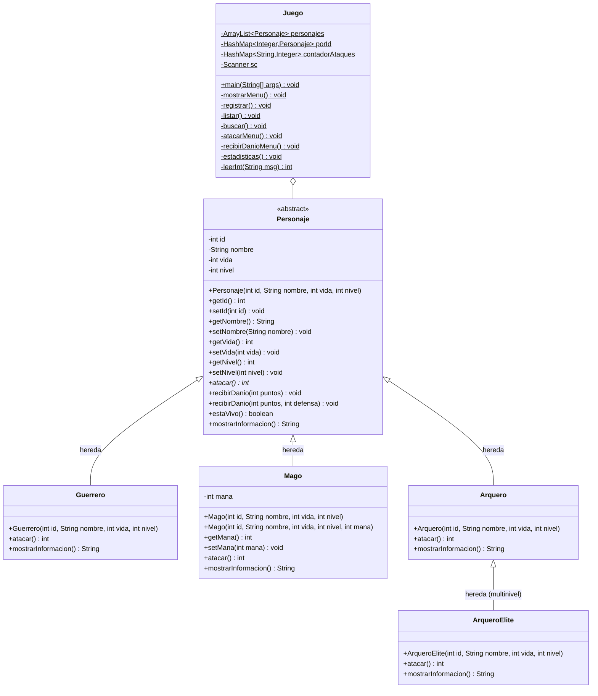

<div align="center">
  <h1 style="border-bottom: none; margin-bottom: 0;">Escuela Politécnica Nacional - EPN</h1>
  <h2 style="border-bottom: none; margin-top: 0; margin-bottom: 0;">Escuela de Formación de Tecnólogos - ESFOT</h2>
  <h3 style="margin-top: 10px;">Sistema Arena de Héroes - POO en Java</h3>
</div>

> **Estudiante:** Melva Patricia Suarez C.  
> **Asignatura:** Programación Orientada a Objetos  
> **Lenguaje:** Java (JDK 17 o superior · probado en JDK 21)

# 🏟️ Arena de Héroes
Videojuego de consola desarrollado en **Java 17+** como **deber integrador** de
Programación Orientada a Objetos. El proyecto integra clase abstracta, herencia
simple y multinivel, encapsulamiento, sobrecarga, sobrescritura, polimorfismo,
`ArrayList`, `HashMap` y un menú interactivo por consola.

## 🚀 Características

- **Clase abstracta** `Personaje` con método abstracto `atacar()` y método
  concreto `mostrarInformacion()`.
- **Herencia simple:** `Guerrero`, `Mago` y `Arquero` heredan de `Personaje`.
- **Herencia multinivel:** `ArqueroElite` hereda de `Arquero`.
- **Encapsulamiento:** todos los atributos son `private`; los setters
  validan y saturan valores fuera de rango.
- **Sobrecarga:** dos versiones de `recibirDanio(int)` y
  `recibirDanio(int, int)`.
- **Sobrescritura:** `atacar()` y `mostrarInformacion()` en cada subclase.
- **Polimorfismo:** un `ArrayList<Personaje>` invoca el `atacar()` correcto
  según la subclase real.
- **Colecciones:** `ArrayList` para listar y `HashMap` para búsqueda O(1)
  por ID y estadísticas por clase.
- **Menú de consola** con 7 opciones (registrar, listar, buscar, atacar,
  recibir daño, estadísticas, salir).

## 📁 Estructura del repositorio
```
arena-heroes/
├── images/                      ← evidencias de pruebas (capturas)
├── src/
│   ├── Juego.java               ← menú + ArrayList + HashMap
│   └── heroes/
│       ├── Personaje.java       ← clase abstracta base
│       ├── Guerrero.java        ← subclase
│       ├── Mago.java            ← subclase
│       ├── Arquero.java         ← subclase
│       └── ArqueroElite.java    ← herencia multinivel
├── Diagrama_arena_heroes.png
└── README.md
```

## 📊 Diagrama UML
> **Imagen:** [Diagrama de clases](Diagrama_arena_heroes.png)


## 🧰 Requisitos previos
- **JDK 17 o superior** (`java -version` debe mostrar 17+).
- Terminal (PowerShell, bash, zsh o CMD).
- Opcional: IDE (IntelliJ IDEA, VS Code, Eclipse) o Git para clonar.

## ▶️ Cómo compilar y ejecutar
### Linux / macOS
```bash
git clone <URL-del-repo>
cd arena-heroes
javac -d out src/heroes/*.java src/Juego.java
java -cp out Juego
```

### Windows (PowerShell)

```powershell
git clone <URL-del-repo>
cd arena-heroes
javac -d out src\heroes\*.java src\Juego.java
java -cp out Juego
```

## 📋 Menú de la aplicación

| Opción | Descripción |
|--------|-------------|
| **1** | Registra un personaje eligiendo tipo (Guerrero / Mago / Arquero / Arquero Élite), ID, nombre, vida y nivel. |
| **2** | Lista todos los personajes registrados con su información completa. |
| **3** | Busca un personaje por ID (búsqueda O(1) con `HashMap`). |
| **4** | Un personaje ataca a otro. Se aplica la fórmula según la subclase (polimorfismo). |
| **5** | Aplica daño a un personaje, con o sin defensa (sobrecarga de `recibirDanio`). |
| **6** | Muestra total, vivos, promedios de nivel y vida, y ataques por clase. |
| **7** | Cierra el programa. |

## 📜 Reglas de negocio

| Regla | Implementación |
|-------|----------------|
| Vida entre **0 y 100** | `setVida` satura a `[0, 100]` |
| Nivel **≥ 1** | `setNivel` lanza `IllegalArgumentException` |
| **ID único** | Verificación con `HashMap.containsKey` antes de registrar |
| Nombre **no vacío** | `setNombre` lanza `IllegalArgumentException` |
| Vida **nunca negativa** | `setVida` fuerza mínimo 0 |
| No atacar a **inexistentes** | `atacarMenu` valida `porId.get(...) == null` |
| No atacar **derrotados** | `estaVivo()` verificado antes del ataque |

### Fórmulas de ataque

| Clase | Fórmula | Extra |
|-------|---------|-------|
| **Guerrero** | `10 + 2 × nivel` | — |
| **Mago** | `8 + 3 × nivel` | Consume **5 de maná** (si no hay maná, ataque = 0) |
| **Arquero** | `9 + 2 × nivel` | — |
| **Arquero Élite** | `(9 + 2 × nivel) + 5` | Bonus de élite |
---
## 🧩 Conceptos de POO aplicados

| Concepto | Dónde se evidencia |
|----------|--------------------|
| **Clase abstracta** | `Personaje` con `atacar()` abstracto |
| **Herencia simple** | `Guerrero`, `Mago`, `Arquero` → `Personaje` |
| **Herencia multinivel** | `ArqueroElite` → `Arquero` → `Personaje` |
| **Encapsulamiento** | Atributos `private` con setters validados |
| **Sobrecarga** | `recibirDanio(int)` / `recibirDanio(int, int)` · dos constructores en `Mago` |
| **Sobrescritura** | `atacar()` y `mostrarInformacion()` en cada subclase |
| **Polimorfismo** | `ArrayList<Personaje>` invoca el `atacar()` real |
| **Colecciones** | `ArrayList` (orden) + `HashMap` (búsqueda O(1) y estadísticas) |

## 🧪 Pruebas documentadas

Cada prueba se ejecutó por consola con `java -cp out Juego`. Las capturas de evidencia se almacenan en la carpeta `images/`.

| # | Caso | Pasos / Entrada | Resultado esperado | Evidencia |
|---|------|-----------------|--------------------|-----------|
| T1 | Nombre vacío | Registrar personaje con nombre vacío | Se rechaza con error: "El nombre no puede estar vacío" | `images/T01_nombre_vacio.png` |
| T2 | Vida > 100 se satura | Registrar personaje con vida 150 | La vida queda en 100 | `images/T02_vida_saturada.png` |
| T3 | Fórmula Guerrero | Guerrero nivel 5 ataca | Daño = `10 + 2*5 = 20` | `images/T03_formula_guerrero.png` |
| T4 | Consumo de maná | Mago ataca | Daño = `8 + 3*nivel` y maná disminuye en 5 | `images/T04_mana_mago.png` |
| T5 | Vida nunca negativa | Aplicar daño mayor a la vida actual | Vida queda en 0, no negativa | `images/T05_vida_no_negativa.png` |
| T6 | Sobrecarga con defensa | Opción recibir daño con defensa | Daño efectivo = `max(0, puntos - defensa)` | `images/T06_sobrecarga_defensa.png` |
| T7 | ID duplicado | Registrar dos personajes con mismo ID | Se rechaza el segundo registro | `images/T07_id_duplicado.png` |
| T8 | Ataque a inexistente | Atacar usando ID objetivo no registrado | Mensaje: no existe/ataque cancelado | `images/T08_objetivo_inexistente.png` |
| T9 | Polimorfismo | Registrar Guerrero, Mago y Arquero; ejecutar ataques | Cada clase usa su propia fórmula de `atacar()` | `images/T09_polimorfismo.png` |
| T10 | Herencia multinivel | ArqueroElite nivel 5 ataca | Daño = `(9 + 2*5) + 5 = 24` | `images/T10_arquero_elite.png` |
| T11 | Nivel < 1 | Registrar personaje con nivel 0 | Se rechaza con error: "El nivel debe ser mayor a uno" | `images/T11_nivel_invalido.png` |
| T12 | Fórmula Arquero | Arquero nivel 4 ataca | Daño = `9 + 2*4 = 17` | `images/T12_formula_arquero.png` |
| T13 | Mago sin maná | Mago con maná insuficiente intenta atacar | Ataque = 0 y muestra mensaje de maná insuficiente | `images/T13_mago_sin_mana.png` |
| T14 | `estaVivo()` / no atacar derrotado | Personaje con vida 0 intenta atacar | Se bloquea: atacante derrotado no puede atacar | `images/T14_esta_vivo.png` |
| T15 | Vida saturada al mínimo | Aplicar daño con valor que deja vida negativa | `setVida` fuerza el mínimo a 0 | `images/T15_vida_saturada_min.png` |

---
> ***Autora:** Melva Suarez*  
> ***Link del repositorio:** [Arena Heroes](https://github.com/MelvaSuarez29/arena-de-heroes.git)*  
> El proyecto académico fue desarrollado con fines educativos como actividad de  implementación de 
> **clases abstractas, herencia, encapsulamiento, sobrecarga, sobrescritura, polimorfismo, `ArrayList`, `HashMap` y UML** en Java.

