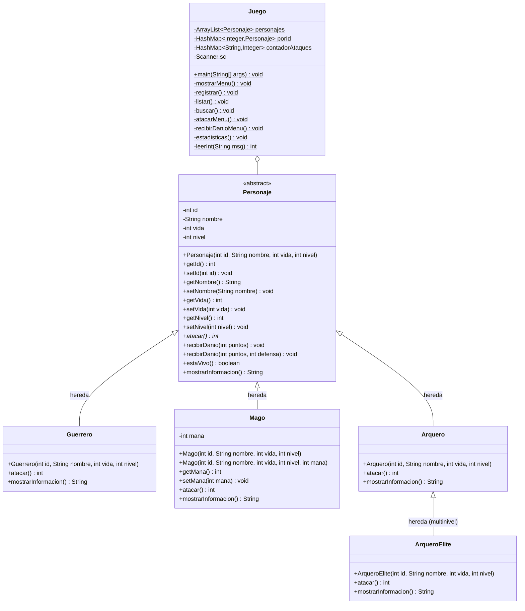

# Escuela Politécnica Nacional - EPN
# Escuela de Formación de Tecnólogos - ESFOT
## Sistema Arena de Héroes - POO en Java  
> **Estudiante:** Melva Patricia Suarez C.  
> **Asignatura:** Programación Orientada a Objetos  
> **Lenguaje:** Java (JDK 17 o superior · probado en JDK 21)

---
# 🏟️ Arena de Héroes

Videojuego de consola desarrollado en **Java 17+** como **deber integrador** de
Programación Orientada a Objetos. El proyecto integra clase abstracta, herencia
simple y multinivel, encapsulamiento, sobrecarga, sobrescritura, polimorfismo,
`ArrayList`, `HashMap` y un menú interactivo por consola.

## 🚀 Características

- **Clase abstracta** `Personaje` con método abstracto `atacar()` y método
  concreto `mostrarInformacion()`.
- **Herencia simple:** `Guerrero`, `Mago` y `Arquero` heredan de `Personaje`.
- **Herencia multinivel:** `ArqueroElite` hereda de `Arquero`.
- **Encapsulamiento:** todos los atributos son `private`; los setters
  validan y saturan valores fuera de rango.
- **Sobrecarga:** dos versiones de `recibirDanio(int)` y
  `recibirDanio(int, int)`.
- **Sobrescritura:** `atacar()` y `mostrarInformacion()` en cada subclase.
- **Polimorfismo:** un `ArrayList<Personaje>` invoca el `atacar()` correcto
  según la subclase real.
- **Colecciones:** `ArrayList` para listar y `HashMap` para búsqueda O(1)
  por ID y estadísticas por clase.
- **Menú de consola** con 7 opciones (registrar, listar, buscar, atacar,
  recibir daño, estadísticas, salir).
---
## 📁 Estructura del repositorio

```
arena-heroes/
├── src/
│   ├── Personaje.java       ← clase abstracta base
│   ├── Guerrero.java        ← subclase
│   ├── Mago.java            ← subclase
│   ├── Arquero.java         ← subclase
│   ├── ArqueroElite.java    ← herencia multinivel
│   └── Juego.java           ← menú + ArrayList + HashMap
├── Diagrama_arena_heroes.png
├── .gitignore
└── README.md
```

## 📊 Diagrama UML
> **Imagen:** [Diagrama de clases](Diagrama_arena_heroes.png)


## 🧰 Requisitos

- **JDK 17 o superior** (`java -version` debe mostrar 17+).
- Terminal (PowerShell, bash, zsh o CMD).
- Opcional: IDE (IntelliJ IDEA, VS Code, Eclipse) o Git para clonar.
---
## ▶️ Cómo compilar y ejecutar
### Linux / macOS
```
git clone <URL-del-repo>
cd arena-heroes
javac -d out src/*.java
java -cp out Juego
```

### Windows (PowerShell)

```
git clone <URL-del-repo>
cd arena-heroes
javac -d out src\*.java
java -cp out Juego
```

### Ejecutar las pruebas

```
# Linux / macOS
javac -d out src/*.java tests/PruebasArena.java
java -cp out PruebasArena

# Windows
javac -d out src\*.java tests\PruebasArena.java
java -cp out PruebasArena
```

Salida esperada: **`RESULTADO: 15/15 pruebas pasadas (0 fallidas)`**.

| Opción | Descripción |
|--------|-------------|
| **1** | Registra un personaje eligiendo tipo (Guerrero / Mago / Arquero / Arquero Élite), ID, nombre, vida y nivel. |
| **2** | Lista todos los personajes registrados con su información completa. |
| **3** | Busca un personaje por ID (búsqueda O(1) con `HashMap`). |
| **4** | Un personaje ataca a otro. Se aplica la fórmula según la subclase (polimorfismo). |
| **5** | Aplica daño a un personaje, con o sin defensa (sobrecarga de `recibirDanio`). |
| **6** | Muestra total, vivos, promedios de nivel y vida, y ataques por clase. |
| **7** | Cierra el programa. |
---
## 📜 Reglas de negocio

| Regla | Implementación |
|-------|----------------|
| Vida entre **0 y 100** | `setVida` satura a `[0, 100]` |
| Nivel **≥ 1** | `setNivel` lanza `IllegalArgumentException` |
| **ID único** | Verificación con `HashMap.containsKey` antes de registrar |
| Nombre **no vacío** | `setNombre` lanza `IllegalArgumentException` |
| Vida **nunca negativa** | `setVida` fuerza mínimo 0 |
| No atacar a **inexistentes** | `atacarMenu` valida `porId.get(...) == null` |
| No atacar **derrotados** | `estaVivo()` verificado antes del ataque |

### Fórmulas de ataque

| Clase | Fórmula | Extra |
|-------|---------|-------|
| **Guerrero** | `10 + 2 × nivel` | — |
| **Mago** | `8 + 3 × nivel` | Consume **5 de maná** (si no hay maná, ataque = 0) |
| **Arquero** | `9 + 2 × nivel` | — |
| **Arquero Élite** | `(9 + 2 × nivel) + 5` | Bonus de élite |
---
## 🧪 Pruebas documentadas
## 🧪 Pruebas documentadas con evidencia

Cada prueba se ejecutó por terminal con `java -cp out Juego`. A continuación
se muestra el caso, la secuencia de entradas, el resultado esperado y la
**captura de pantalla** que lo evidencia.

## 🧩 Conceptos de POO aplicados

| Concepto | Dónde se evidencia |
|----------|--------------------|
| **Clase abstracta** | `Personaje` con `atacar()` abstracto |
| **Herencia simple** | `Guerrero`, `Mago`, `Arquero` → `Personaje` |
| **Herencia multinivel** | `ArqueroElite` → `Arquero` → `Personaje` |
| **Encapsulamiento** | Atributos `private` con setters validados |
| **Sobrecarga** | `recibirDanio(int)` / `recibirDanio(int, int)` · dos constructores en `Mago` |
| **Sobrescritura** | `atacar()` y `mostrarInformacion()` en cada subclase |
| **Polimorfismo** | `ArrayList<Personaje>` invoca el `atacar()` real |
| **Colecciones** | `ArrayList` (orden) + `HashMap` (búsqueda O(1) y estadísticas) |

## 📷 Capturas de pantalla / Screenshots
Cada prueba se ejecutó por terminal con `java -cp out Juego` o `IntelliJ IDEA`. A continuación
se muestra el caso, la secuencia de entradas, el resultado esperado y la
**captura de pantalla** que lo evidencia.

| # | Caso | Tipo | Resultado | Evidencia |
|---|------|------|:---------:|:---------:|
| T1  | Nombre vacío | Validación | [ ] | [ ver](#t1) |
| T2  | Vida > 100 se satura | Validación | [ ] | [ ver](#t2) |
| T3  | Fórmula Guerrero | Sobrescritura | [ ] | [ ver](#t3) |
| T4  | Consumo de maná | Regla de negocio | [ ] | [ver](#t4) |
| T5  | Vida nunca negativa | Validación | [ ] | [ ver](#t5) |
| T6  | Sobrecarga con defensa | Sobrecarga | [ ] | [ ver](#t6) |
| T7  | ID duplicado | Regla con HashMap | [ ] | [ver](#t7) |
| T8  | Ataque a inexistente | Regla de negocio | [ ] | [ ver](#t8) |
| T9  | Polimorfismo | Polimorfismo | [ ] | [ ver](#t9) |
| T10 | Herencia multinivel | Herencia | [ ] | [ ver](#t10) |
| T11 | Nivel < 1 | Validación | [ ] | [ ver](#t11) |
| T12 | Fórmula Arquero | Sobrescritura | [ ] | [ver](#t12) |
| T13 | Mago sin maná | Regla de negocio | [ ] | [ ver](#t13) |
| T14 | `estaVivo()` | Regla de negocio | [ ] | [ ver](#t14) |
| T15 | `setVida(-10)` | Validación | [ ] | [ ver](#t15) |

---
> ***Autora:** Melva Suarez*  
> ***Link del repositorio:** [Arena Heroes](https://github.com/MelvaSuarez29/arena-de-heroes.git)*  
> El proyecto académico fue desarrollado con fines educativos como actividad de
implementación de **clases abstractas, herencia, encapsulamiento,
sobrecarga, sobrescritura, polimorfismo, `ArrayList`, `HashMap` y UML** en
Java.

